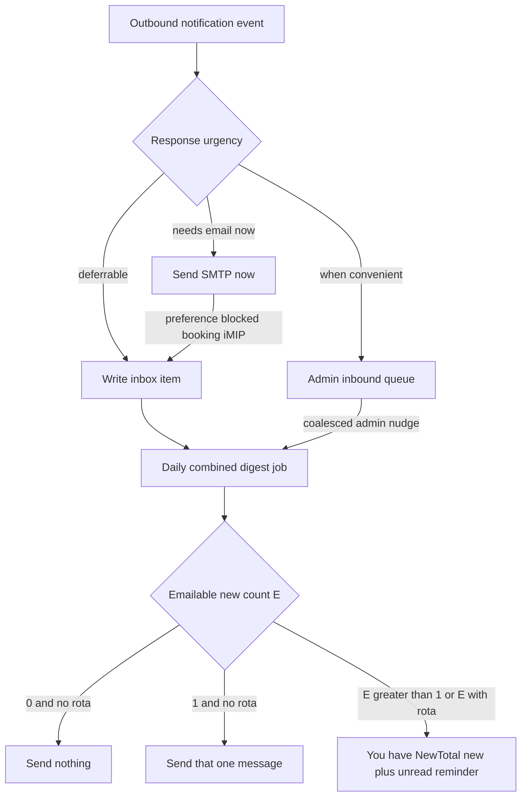

# In-app notification inbox + combined digest

## Product rules (locked)

Classify by **how soon someone must act or see it**, not by how often it fires or how many recipients it has. SMTP quota is a benefit of deferring low-urgency mail, not the primary taxonomy.

- **Immediate (needs email now):** calendar correctness (iMIP), account access, and break-glass ops that leave the team unsafe or unstewarded if ignored until tomorrow.
- **Deferrable (inbox + daily flush):** informational or same-day-is-fine manager/member notices. Land in the app Inbox immediately; SMTP only via the daily combined job rules below.
- **When convenient (admin queue):** unhandled inbound — review in Admin when able; batched “something to review” nudge only, never per-message SMTP.
- **Preference sink:** when [US-61](stories/US-61-notification-settings.md) would block an optional/immediate booking send, still write an in-app inbox item (no ICS) so nothing is lost.
- **Manager “always-on”** means the channel cannot be muted for recording / digest eligibility — not that every manager alert must send SMTP immediately.
- **Daily combined email** (extends [US-17](stories/US-17-schedule-digest-changelog.md)): one message per member (including managers). **Inbox / “you have N new notifications” before the rota digest.**

Deferrable mail: **no** immediate SMTP; inbox now + daily flush. Preference off: still write inbox (in-app-only until emailable).

## Delivery tiers (by urgency)

### `immediate` — needs email now

Must reach the person (or their calendar) before the next digest cycle.

- **Calendar sync:** `BookingInviteMail`, `BookingChangedMail` / `BookingConfirmedMail`, `BookingCancelledMail`, `BookingIcsRefreshMail` (when preference allows). If preference blocks these, write a lightweight inbox item instead (no ICS).
- **Account access:** password reset, verify-email, team/site invitation mail.
- **Break-glass ops:** `LastManagerLeavingNotification` (team left without an active manager); `KeyRingHolderLeavingNotification` (someone deleted while still holding rings — stewardship gap now).

### `inbox` — deferrable (same day / next digest is fine)

Useful to see soon in-app; email can wait for the daily combined job.

- **Member:** `AttendanceRecordedMail`; `KeyRingPassedToNotification` / `KeyRingPassedFromNotification`; future comments / news / US-16 nudges; `TeamInvitationDeclinedNotification` (nice-to-know, not time-critical).
- **Manager:** `LeadNeededMail` (assign a lead before the session — visible in-app; daily ping enough unless we later add a “booking within 48h” escalate); `KeyRingReturnedToCupboardNotification` (inventory awareness, not emergency).

### `admin_queue` — when convenient

- Unhandled inbound: store on `InboundMail` for Admin review. **No per-message SMTP.** Coalesce a system-admin inbox/digest nudge (“N inbound emails need review”) with a link to Admin → Inbound mail.

Centralise classification in `App\Support\NotificationDelivery` (or similar) so callers pick a tier by urgency, not ad hoc `Mail::to` / `notify`.

Managers use the same member Inbox UI for deferrable manager items. US-61 manager group stays non-togglable for those. Unhandled inbound review stays **system-admin**.

## Data model

- Prefer table name `member_notifications` or `inbox_messages` (avoid clashing with Laravel’s database `notifications` channel).
  - `user_id`, `type`, `title`, `body` (or markdown), optional `subject_type` / `subject_id`, `mail_channel`, `data` JSON
  - `read_at`, `digest_notified_at`, timestamps
- Factory + policy: member can only see own rows.
- Unread count for nav badge.

When writing from a suppressed preference path, still store the same content that would have been emailed (subject + body), without ICS attachments.

## Member UI

- Member panel page **Inbox** (user menu), list unread/read, mark read, open related booking/key ring when morph is set.
- Unread badge on the nav item.
- Preference footers stay on immediate optional mail only. US-61 copy should note that turning a channel off keeps messages in the inbox and may still surface them in the daily digest summary.

## Combined digest (US-17 + inbox)

Scheduled daily job per user (or chunked query):

1. If `MailPreference::allows(..., BookingsDigest)`: compute US-17 rota delta (additions / removals / remaining future “Can help” rota) and persist the last-digest snapshot as US-17 requires. If `bookings.digest` is **off**, **treat the rota delta as empty** (do not include a changelog section; still advance the snapshot when off so turning digest back on does not dump a huge backlog — document on US-17).
2. Load inbox items. Define:
   - **New** = `digest_notified_at` null (awaiting a digest/inbox email mention).
   - **Unread** = `read_at` null (not yet opened in the app Inbox).
   - **Emailable new** = new items whose `mail_channel` passes `MailPreference::allows` (always-on manager/admin nudges always emailable). Preference-suppressed new items stay in the app Inbox and count toward “new” / “unread” copy, but do **not** alone trigger a send.
3. Let `R` = rota delta non-empty, `E` = emailable new count (include coalesced admin inbound-review nudge as one emailable item for system admins when due), `NewTotal` = all new items (emailable + in-app-only), `UnreadTotal` = all unread items.
4. **Send decision** (gated by emailable / rota only):
   - `E = 0` and not `R` → **send nothing**
   - `E = 1` and not `R` → **send that one emailable message** as the email (full title/body / deep link; no “you have X” wrapper)
   - `E > 1`, or `E >= 1` and `R` → **combined/summary mail**, section order:
     1. **Inbox first** — uses **total new**, not only emailable — e.g. “You have :NewTotal new notifications” + inbox URL. Do **not** embed the single item when a rota section will also appear. **Only on this summary section**, also remind of unread when useful, e.g. “(:UnreadTotal unread in your inbox)” — omit the unread clause if `UnreadTotal` is 0 or equals `NewTotal` and would read redundantly (pick one clear line in implementation).
     2. **Rota digest second** (only if `R`) — US-17 changelog / roster content.
5. After a successful send: set `digest_notified_at` on **all new items that were counted in that send’s NewTotal** (so preference-suppressed new items included in the “you have X new” figure are also marked notified and do not inflate X forever). The single-message path stamps only that one item.
6. Show `bookings.digest` on the Notifications page. **`bookings.digest` off = no rota content** (delta treated as 0). Inbox email still follows the `E` / `R` send gate and the `NewTotal` / `UnreadTotal` copy rules. Document on US-17 / US-61.

Examples: digest off + one emailable key-pass → that key-pass mail alone. Digest on + rota + one lead-needed → “you have 1 new notification” (+ unread reminder if applicable), **then** the changelog. Three emailable new, no rota → “you have 3 new notifications”. Two emailable new + three preference-blocked new, no rota → still send (E>1) with “you have 5 new notifications”.

No per-booking `References` on this mail (US-17).

## Preference interaction

- **Immediate iMIP channels:** `MailPreference::allows` still skips SMTP when off; **also** write a lightweight inbox item (“Booking updated: …”) so the member can see it in-app without calendar MIME. Do **not** attach ICS to inbox-only copies (iMIP only on real SMTP). Those preference-blocked items are **in-app-only** until the channel is on again (not emailable for the daily job).
- **Inbox-tier channels:** always write inbox. **Send gate** uses emailable new count `E` (`MailPreference::allows`; always-on always emailable): `E=0` and no rota → no send; `E=1` and no rota → send that message; `E>1` or `E` with rota → summary section. **Summary copy** uses **total new** (`NewTotal`), not only `E`, and may add **total unread** only on that summary section.
- Invite list **No email** badge stays based on `bookings.mail` (immediate invite still skipped when off).

## Stories / docs

- New story **US-66 Member notification inbox** for inbox UI, urgency tiers, preference-suppressed capture, and digest coupling.
- Update [US-17](stories/US-17-schedule-digest-changelog.md): same daily job also carries outstanding inbox notice **above** the rota section; single vs many wording; `bookings.digest` off suppresses rota content only (delta treated as empty), not inbox flush.
- Update [US-61](stories/US-61-notification-settings.md): inbox destination when optional mail is off; manager “always-on” = always recorded / digestable, not always immediate SMTP; show `bookings.digest`; clarify digest vs master `bookings.mail` (neither must be on for inbox pings).
- Update [US-27](stories/US-27-manager-overridden-attendance.md): attendance-recorded goes to inbox (+ digest), not immediate SMTP.
- Update lead-needed / US-10–11 related progress and [US-51](stories/US-51-pass-a-key-ring.md): lead-needed and cupboard-return → inbox; holder pass → inbox.
- Update [US-55](stories/US-55-inbound-email-routing-and-alerts.md): drop per-message manager email for unhandled inbound; Admin queue is the review surface; system admins get a batched “N need review” nudge (inbox/digest), not one mail per webhook. Successful REPLY/REFRESH still silent.
- Leave US-15/28 iMIP apply behaviour unchanged.

## Implementation order

1. Model + migration + member Inbox page (read/mark read) with factory.
2. `NotificationDelivery` router keyed by urgency; migrate deferrable senders to `inbox` (incl. invitation declined); stop per-message `UnhandledInboundMail`; coalesced system-admin inbound nudge; keep calendar/auth/break-glass on `immediate`.
3. Preference-off path: write inbox item when optional (and when immediate booking update/invite is suppressed).
4. Daily combined digest job + mailable (incl. admin inbound count for system admins); enable `bookings.digest` on Notifications; update stories.
5. Focused tests: urgency tier routing, no per-message unhandled-inbound SMTP, coalesced admin nudge, preference-off still creates inbox, digest send/skip/single/many, iMIP/auth/break-glass still immediate.

## Out of scope this slice

- Push/mobile; Filament database notifications as the product inbox.
- Changing iMIP attach behaviour on invites/updates/cancels.
- Time-based escalation (e.g. lead-needed becomes immediate if the booking is within 48 hours) — note as a later refinement if daily deferral proves too slow.
- Full US-16 nudges / US-40 comments / US-54 news content (reserve as `inbox` / deferrable when those stories land).
