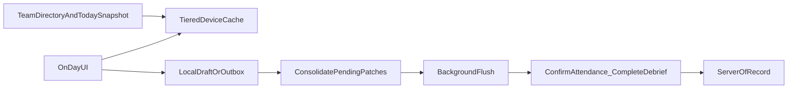

# Mobile / PWA — exploration note

Priorities and design constraints for mobile-first on-the-day use and a progressive web app. Not a relaunch blocker, not a native app commitment, and not a formal user story yet — this note is the holding place (same role as [merchandise-stash-domain](stories/merchandise-stash-domain.md)).

**Phase 0** (installable shell, online only) is in progress in the app. **Phases 1–2** (offline read cache and write outbox) stay design-only here until scheduled. Phase 0 must not be described as “offline ready.”

## Purpose and non-goals

- Keep on-the-day mobile priorities visible so normal Filament work does not paint us into a corner.
- Explicit non-goals until later phases: offline booking PII as a general feature, kit workflows, merchandise, admin panels, push notifications, richer offline comment posting.

## Phasing

| Phase | Scope | Status |
| --- | --- | --- |
| **0** | Installable shell: web manifest (`start_url` → member dashboard), minimal service worker (static assets + offline fallback page only), login/home return to `/dashboard` | Done |
| **1** | On-the-day **read** cache (today’s bookings, tiered directory / roster / Contact PII) | Design only |
| **2** | On-the-day **write** outbox (rollcall, debrief, PATCH merge, US-58 local ack sync) | Design only |

## Priority surfaces (mobile-first)

### Read (on the day)

- Today’s bookings (member / lead / manager views as already authorised).
- Attendees plus contacts (time-windowed per [US-18](stories/US-18-lead-instructor-contact-access.md) / [US-19](stories/US-19-participant-lead-contact-access.md) + [US-58](stories/US-58-personal-data-viewing-acknowledgement.md)) — including **attendee → lead/manager** contact for running late / emergency, not only lead → participant.
- Qualifications and keys ([US-52](stories/US-52-lead-instructor-session-roster.md)).
- Tasks, related bookings, existing comments ([US-22](stories/US-22-task-management.md), [US-37](stories/US-37-related-bookings-multi-day.md), [US-40](stories/US-40-booking-commenting-threads.md)).

### Write (on the day)

- Rollcall / Confirm attendees ([US-42](stories/US-42-post-session-debrief.md); `ConfirmAttendanceAction`).
- Debrief ([US-42](stories/US-42-post-session-debrief.md); `CompleteDebriefAction`).
- Delayed / background submission when connectivity is poor.
- Consolidation of differing pending PATCHes (outbox merge before flush) so partial rollcall marks and a later debrief payload do not stomp each other or replay as conflicting full replaces.

## Team-member cache (Phase 1)

Rollcall can pull in **any non-suspended team member**, not only people already on the guest list (`ConfirmAttendeesAction::searchAddable`). Caching only today’s attendees is not enough for offline rollcall.

| Tier | What | Who may hold it offline | Notes |
| --- | --- | --- | --- |
| **Directory** | Member id, display name, avatar | Lead/manager who can run rollcall for a team with a booking spanning today | Enough to search and add someone to local rollcall marks |
| **Roster enrichment** | In-date quals (incl. permit restrictions), key rings | Same actor; **whole team** | **Primary goal:** instant access on-site with no signal — especially qualifications ([US-52](stories/US-52-lead-instructor-session-roster.md), [US-66](stories/US-66-audience-qualification-requirements.md)). Less sensitive than Contact PII. Day-slimming (quals for today’s activity/audience; keys for today’s venues/locks) is payload/storage optimisation, not a privacy requirement; prefer useful qualification detail over aggressive trim |
| **Contact PII** | Phone, emergency contact | Two audiences | **(A) Lead/manager:** warm whole-team contact when they have an in-window booking spanning today. **(B) Attendee / invitee (accepted/tentative), including non-team-members:** warm only what stories/policy already allow — lead phone + emergency ([US-19](stories/US-19-participant-lead-contact-access.md)); phone for team managers who are also attending (`BookingAttendancePolicy::viewPhone`). Never whole-team contact onto attendee devices. Non-members discover the booking via the **member** dashboard and open the same booking detail they already get online |

### Safety / hygiene

- Scope prefetch by role: lead/manager directory + whole-team Contact PII + roster enrichment only when they have a booking spanning today; attendees get today’s booking snapshot plus **narrow** lead / attending-manager Contact PII. Non-member invitees do not get team directory or roster enrichment.
- Exclude suspended members; drop them on next successful sync.
- **Expire using story windows:** wipe Contact PII, directory, and read snapshot when [US-18](stories/US-18-lead-instructor-contact-access.md) / [US-19](stories/US-19-participant-lead-contact-access.md) (and “no remaining relevant booking today”) say the window ends; also wipe on logout or when eligibility ends. Do **not** keep the directory overnight for next-day offline debrief.
- **Refresh while warm:** re-fetch on reconnect / periodic background sync so revoked membership, suspension, and edited phone/emergency details replace the device copy.
- Treat device storage as sensitive (encrypted IndexedDB / platform storage where available); Contact PII is the highest-sensitivity tier.
- Server remains source of truth; when an offline-added member flushes, server re-checks membership, suspension, and authorisation.

**Non-team-member invitees:** no separate offline path. Same attendee read + Contact PII rules; entry is member dashboard → booking. [US-50](stories/US-50-invite-non-members.md) is still deferred for inviting; roster access outside membership is already called out in [stories/README](stories/README.md) (Attendee role).

**US-58 offline:** do **not** prefetch acknowledgement rows. Record acknowledgements **locally** (per-person / per-section / 30 minutes), gate Contact PII display on that local record, and **sync acknowledgements out** when signal returns for the server audit trail. If offline and there is no local acknowledgement (or it has expired), the user acknowledges again.

**Team size:** not expected to be a problem for typical teams. Monitor payload bytes per tier and device storage growth once a cache exists — not a design blocker up front.

## Snapshot retention (Phase 1)

- **Warm only when useful:** prefetch only when the actor has at least one relevant booking **spanning today** (booking timezone) where they are lead or manager (or, for attendees, a booking they attend today).
- **Pending outbox ≠ directory:** if rollcall / debrief is already composed and only waiting to flush, keep the queued payload; directory and Contact PII can be wiped.
- **Not composed by end of day:** no overnight offline debrief for now. Completing debrief after the day is an **online** action.
- **Later (not now):** a next-day warm could stay light — member ulid + name, plus attendance for bookings awaiting debrief — without Contact PII. Parked.

## Sync / write outbox (Phase 2)

### Conflict / late-sync assumptions

- **Debrief already completed** when an offline debrief finally flushes: non-error. Another lead/manager got there first; expect same/similar data. Drop or no-op the local payload and refresh from server. **No actor-facing notice.**
- **Attendance mark conflicts:** **later timestamp wins** (after device–server delta). Prefer per-attendee marks with client event time over whole-form last-write.

## Design constraints (“don’t block”)

Use these during normal feature work:

- **Client time is a sync norm:** device clocks drift. Any offline-originated event that orders, expires, or conflicts on time should carry the device’s event time **and** send device `now` on each sync/flush so a **device–server delta** can normalise times. Prefer this pattern by default for new sync payloads.
- Prefer invokable Actions (or similar domain services) for attendance, debrief, and other on-the-day mutations; avoid Filament-only side effects that a sync path cannot reuse.
- Prefer merge-friendly write shapes (per-attendee marks with client timestamps) over “replace entire form state” where possible.
- Avoid baking critical on-the-day data only into Livewire ephemeral state or one-shot modal closes with no durable draft model.
- Keep Contact PII display behind US-58 and calendar-day windows. Offline: local ack → optional outbox sync. Warm whole-team contact only onto lead/manager devices; warm lead (+ attending manager phone) onto attendee devices per US-19. Offline booking detail must match existing story visibility. Keep directory / roster / contact tiers separable.
- Prefer progressive enhancement on booking view / today’s schedule surfaces rather than desktop-only dense tables for the same jobs.
- When changing rollcall “add person” search or team-member listing, prefer shapes that could back a prefetchable directory snapshot (stable ids, name, avatar, team scope).

## Current anchors

- Write logic already lives in invokable Actions used by Filament modals.
- UI already uses `modal-mobile-full` in several booking panels; responsive affordances are not the same as offline/PWA.
- No general member API yet (`routes/api.php` is webhooks-only) — later offline clients need stable, authorisation-aware read/write contracts, including a team directory snapshot for rollcall.
- GDPR / contact windows are calendar-day based in the booking timezone — offline caches must respect expiry, not just “last sync”.
- Phase 0: `public/site.webmanifest` (`start_url` `/dashboard`), browser icons partial, minimal service worker + offline fallback page (static only).

## Formal stories

No dedicated PWA user story yet. Add a `US-xx` when Phase 1 or 2 is scheduled and needs backlog status and acceptance criteria. Until then this note is enough.
