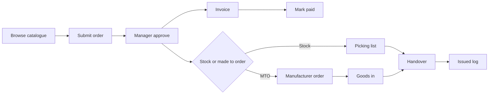

# Merchandise & Stash — domain note

Per-team shop for branded and personalised clothing and stash. Not booking equipment sets, not an automated entitlement engine, and not online payments. Scope is `extra`; nothing here is a relaunch blocker.

Anchor stories: [US-36](US-36-merchandise-stash-requests.md) (shop), [US-24](US-24-equipment-merchandise-allocation.md) (issued items). Children: [US-82](US-82-merchandise-catalogue-and-stock.md)–[US-87](US-87-merchandise-picking-and-handover.md).

## Glossary

| Term | Meaning |
| --- | --- |
| **Manufacturer** | A per-team controlled supplier record. Catalogue items associate to a manufacturer so [US-86](US-86-merchandise-manufacturer-orders.md) can group lines when building an outward order. |
| **Catalogue item** | A sellable product on one team: title, description, image, manufacturer, fulfilment type (stock or made-to-order), availability, optional personalisation fields, and one or more sizes each with a price. |
| **Availability** | Lifecycle on items and variants: **draft** (being prepared) → **available** (on sale) → **mothballed** (soft-retired). Draft and mothballed are hidden from the shop; mothballing keeps past orders and issued history intact. |
| **Variant** | An issuable / orderable SKU on an item. Price, availability, and later stock sit on the variant. Basket and order lines reference a variant and snapshot its label. Schema: `merchandise_item_variants`. |
| **Option axis** | An optional dimension on a catalogue item (e.g. Size, Colour) with a closed list of values. Variants bind to one value per axis; the composed label (e.g. `M · Orange`) is derived for display. Zero axes keeps today’s free-text variant labels. Schemas: `merchandise_item_option_axes`, `merchandise_item_option_values`, `merchandise_item_variant_options`. |
| **Personalisation** | Extra free-text fields on an item (e.g. name on shirt) the member fills when ordering. Closed-list personalisation is separate from SKU axes and not modelled yet. |
| **Order** | A member’s request for one or more line items from that team’s catalogue. |
| **Approval** | Manager accept or reject (with reason), including discretionary line discounts and an optional order-level value discount. |
| **Invoice** | Amount the member owes after approval. Payment is offline (cash, cheque, bank transfer); the site only tracks unpaid / paid. |
| **Manufacturer order** | Manager-built list of made-to-order (and optionally restock) lines for **one** manufacturer from the team’s manufacturer list, to send outside the app. |
| **Picking list** | Lines to fulfil from on-hand stock. |
| **Goods in** | Recording stock or ordered items arriving from a manufacturer, possibly in partial batches across orders. |
| **Handover** | Marking that an ordered line (or gift) has been given to the member. Collection vs post is informal. |
| **Issued item** | Record that a member has received a catalogue item (from handover or a gift recorded without a shop order). Used for manager judgment, not auto free-item rules. |

## Lifecycle (happy path)

Amend or cancel is allowed until the line has been sent on a manufacturer order, or until it is handed over when fulfilled from stock. Reject (manager or after manufacturer feedback) needs a reason.

Partial fulfilment is normal: one member order may span several manufacturer deliveries and several handovers.

## Ordering patterns

The same shop flow covers both:

- **Campaign / bulk supplier run** — managers leave relevant items available for a stretch (e.g. a month), members submit and amend orders while the window is open, then managers approve and raise one (or a few) manufacturer orders. Closing the window is operational (comms, then “send manufacturer order”), not an automated campaign object in the app.
- **Ad-hoc requests** — a member orders when they need something; managers approve and fulfil from stock or fold the line into the next manufacturer order.

No separate campaign entity is required for the first build. Availability (mothball / available) and the amend-until-sent cutoff are enough to run either pattern.

## Money and treasurer

- Approval stores approved unit prices, an optional order-level discount, and locks **`amount_due`** on the order ([US-84](US-84-merchandise-order-approval.md), [US-85](US-85-merchandise-invoices.md)).
- [US-85](US-85-merchandise-invoices.md) tracks unpaid/paid via `paid_at` on the order (no separate invoice table). £0 due is marked paid on approve.
- When due > 0, approve emails the treasurer asking them to invoice the member (Cc member and manager). Optional team `treasurer_email` prefills that send. There is no in-app treasurer role and no card payments.
- Managers filter unpaid orders and mark paid when money has arrived. The treasurer confirms receipt with the member outside the app.
- Partial payment, credit notes, and price disputes after pay are handled by the treasurer outside the site.
- Example without an in-app credit ledger: member paid, manufacturer shortfall, new order for different items — manager applies an order-level £ discount on approval to balance the prior credit.

## Stock

- Stock quantity is a simple number on a size: decreases when items are issued from stock; managers may edit it manually.
- Reservation at pick vs approve does not matter at team scale; shortage becomes a backorder.
- No fancy stocktake, write-off workflow, or member returns in this domain.

## Entitlements and discounts

What the team covers is a **policy decision outside the app** (trustee board and the team manager’s manager). Examples of that policy, not system rules:

- First necker free; replacements charged.
- A polo (or similar) provided to members.
- The equivalent cost of a provided item taken off another (e.g. hoody priced down by the polo allowance).

Team managers apply that policy at approval as full or partial **line** discounts and/or an **order-level** value discount when the credit does not attach to one line. They need the issued-items log to see what someone has already had (and what was gifted outside the shop) before deciding. The app does **not** encode entitlement rules, allowance balances, or “spend the polo credit on a hoody” automation. Fixed subsidy rules and discount codes are deferred.

## Catalogue availability

- Items and variants use draft → available → mothballed. Soft-retire with mothball (not hard delete when history exists) so order history, invoices, and issued records keep a stable reference. Unused variants may still be deleted.
- An available item needs at least one available variant (and at least one image). A mothballed item needs at least one available or mothballed variant.
- Members only browse and order **available** items and variants. Managers still see draft and mothballed catalogue rows for prep, history, and re-activating.
- Shop list stays one card per catalogue item. When an item has option axes, the product view uses one select per axis (cascading from available SKUs); a complete selection resolves to a single variant. Sparse matrices are allowed (not every Size×Colour need exist). Zero-axis items keep a flat variant select when there is more than one SKU.

## Team boundary

- Manufacturers, catalogue, stock, orders, invoices, manufacturer orders, and issued items are **per team**.
- All current team members may order. No cross-team shopping.

## Navigation (Teams panel)

Feature-gated **Merchandise** group (Shop flag), first among Teams nav groups (then Manage, Setup, Admin), alphabetical: **Issued**, **Items**, **Orders**, **Shop** (with nested **Basket**). Managers see all team orders; members see their own. Member panel later may list orders across teams and link into the Teams panel for detail — shopping stays on the team tenant.

## Manager triage widgets (open)

Managers will need dashboard-style triage for merchandise work in flight — at least pending approval ([US-84](US-84-merchandise-order-approval.md)), unpaid orders ([US-85](US-85-merchandise-invoices.md)), and fulfilment queues ([US-86](US-86-merchandise-manufacturer-orders.md) / [US-87](US-87-merchandise-picking-and-handover.md)). **Placement is undecided:** extend the existing Manager dashboard, or add a Merchandise dashboard (or similar). Do not invent widgets until that home is chosen. Unpaid can already be filtered on Orders.

## Explicitly not this domain

- Booking **equipment sets** / equipment set groups (session kit).
- Automated campaign or “order by Friday” batch objects (deadlines stay informal; see Ordering patterns).
- Postage, collection method, or postal address as first-class fulfilment fields.
- Member returns, cross-team catalogue, online payment gateways.

## Notification moments

Members and/or managers should be notified (inbox and/or mail per [US-61](US-61-notification-settings.md) / [US-67](US-67-member-notification-inbox.md)) when an order is submitted, approved or rejected, invoiced, marked paid, ready for handover, and handed over. Exact channels and preference keys are decided at build time; each child story that creates a state change should name the notice.
